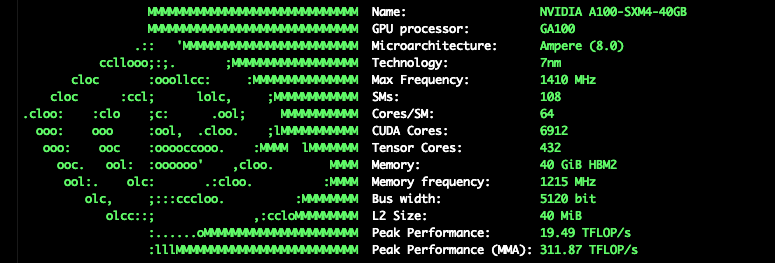

# setup_gpu_fetch

A small setup script that builds and runs the
[gpufetch](https://github.com/Dr-Noob/gpufetch) tool on the
**Meluxina** supercomputer (LuxProvide).

`gpufetch` is a simple command-line utility that prints an ASCII picture of your
GPU (and CPU) architecture along with key specifications (name, device ID,
memory, PCIe info, compute capability, etc.).



> **Author:** Marco Magliulo (LuxProvide)
> **License:** free to use and share openly.

---

## ⚠️ Run this from a GPU compute node

The **build and run** steps must be executed **from inside a Meluxina GPU
compute node** — not from the login node.

So the workflow is:

1. Log in to Meluxina (login node).
2. Start an **interactive job** on a GPU node (see an example command below).
3. Once the interactive shell lands you on a compute node, run the script there.

### 1. Start an interactive GPU job

Request an interactive job on a GPU node with `salloc`:

```bash
salloc -A p20xxxx -t 01:00:00 -q dev --reservation=gpudev -p gpu -N 1
```

| Flag | Meaning |
| ---- | ------- |
| `-A p20xxxx` | Your project/account ID — **replace `p20xxxx` with your own**. |
| `-t 01:00:00` | Wall time: 1 hour (adjust as needed). |
| `-q dev` | Queue/partition. |
| `--reservation=gpudev` | GPU developer reservation. |
| `-p gpu` | Request a GPU partition node. |
| `-N 1` | Number of nodes. |

See the the documentation for details on interactive jobs: [docs.lxp.lu — Interactive jobs](https://docs.lxp.lu/first-steps/handling_jobs/#interactive-jobs)

### 2. Run the setup script

From the interactive shell on the compute node:

```bash
./setup_gpu_fetch.sh
```

The script will:

1. Clone `gpufetch` from GitHub.
2. Load the required environment modules (`CUDA`, `CMake`).
3. Build gpufetch for CUDA (`./build.sh cuda`).
4. Launch `./gpufetch`, which prints your GPU info.

On subsequent runs the clone step is skipped if the `gpufetch/` directory
already exists, so you can simply re-run the script to rebuild and re-run the
tool.

---

## Requirements

- Access to the Meluxina supercomputer.
- A valid project/account ID (for the `-A` flag above).

---

## References

- gpufetch: <https://github.com/Dr-Noob/gpufetch>
- Meluxina docs: <https://docs.lxp.lu>
